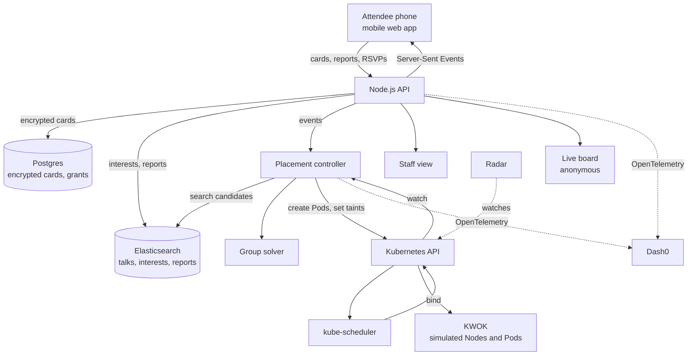

# Affinity

> **Nobody should fly to a conference and end up standing alone.**

Affinity helps people at a large conference find a talk they can actually attend and a few people they can actually talk to. It runs the conference on Kubernetes, literally: attendees are Pods, rooms and tables are Nodes, and seats are a schedulable resource.

Built at the [Cloud Native Hackathon](https://www.wemakedevs.org/hackathons/cnh) in Salt Lake City on November 9, 2026, the day KubeCon + CloudNativeCon North America begins.

> [!IMPORTANT]
> **Project status: design draft.** This README describes the system we set out to build. Before submitting, update the [build status](#build-status) table so it only claims what really works. Replace every value written like `<THIS>`.

---

## Contents

- [The problem](#the-problem)
- [What Affinity does](#what-affinity-does)
- [A walkthrough](#a-walkthrough)
- [Why Kubernetes?](#why-kubernetes)
- [The card](#the-card)
- [Accessibility principles](#accessibility-principles)
- [Architecture](#architecture)
- [How talk placement works](#how-talk-placement-works)
- [How groups are formed](#how-groups-are-formed)
- [Live room reports](#live-room-reports)
- [Data model](#data-model)
- [API](#api)
- [Privacy and safety](#privacy-and-safety)
- [Tech stack](#tech-stack)
- [How we use each sponsor tool](#how-we-use-each-sponsor-tool)
- [Observability and SLOs](#observability-and-slos)
- [Repository layout](#repository-layout)
- [Getting started](#getting-started)
- [Configuration](#configuration)
- [Deployment](#deployment)
- [Testing](#testing)
- [Demo script](#demo-script)
- [Failure modes](#failure-modes)
- [Known limitations](#known-limitations)
- [Prior art](#prior-art)
- [Build status](#build-status)
- [Roadmap](#roadmap)
- [Team](#team)
- [AI disclosure](#ai-disclosure)
- [Hackathon compliance](#hackathon-compliance)
- [Acknowledgements](#acknowledgements)
- [License](#license)

---

## The problem

Big conferences are built for one imagined attendee: someone who can hear every conversation, cope with every crowd, walk up to strangers, and always arrive early enough to get a seat.

Real attendees run into three problems.

**1. You can't tell whether you can attend a talk until you get there.** Talks run in parallel and rooms fill up. The schedule tells you what's on, but not whether there's a seat, whether the room is overwhelming, or whether the captions are working.

**2. The best part of a conference is the hardest part to access.** People often say the hallway conversations are what make a conference worthwhile. Those conversations are also loud, crowded and unstructured. Most accessibility work focuses on talks, through captions and interpreters, while the space between talks is left to chance.

**3. You have to explain yourself over and over.** Someone who is deaf, who stutters, who is blind, or who is autistic may have to explain how to communicate with them to every new person, in the noisiest possible place, before the real conversation can begin.

The people who are most likely to end up alone are often the people who had the hardest time getting there in the first place.

---

## What Affinity does

1. **You make a small card on your phone.** It says what you're working on and how people should talk to you.
2. **It finds you a talk.** The talk matches your interests, has seats, and meets your needs.
3. **It moves you if things change.** If a room fills up or closes, you get the next best option before you've walked over.
4. **It gives you people at every break.** You get a small group, a time and a place, such as "3:30, the quiet table by the window."
5. **Everyone reads the cards first.** You can skip the explanation and get to the conversation.
6. **It remembers who you met.** If you both agree, you keep the person's name and where you met.

---

## A walkthrough

Alex is at KubeCon for the first time, reads lips, and doesn't know anyone there.

| Time | What happens |
|---|---|
| **9:00** | Alex scans a QR code and picks the "I read lips" template. The card takes less than 30 seconds to make. |
| **9:05** | Alex says they're interested in making apps start faster and need working captions in talks. |
| **9:06** | Affinity places Alex in a matching talk in a room with seats and working captions. |
| **10:40** | The captions in the next room stop. Someone taps "captions down." Staff get an alert, and Alex gets a new option before leaving their seat. |
| **3:30** | Affinity places Alex at a quiet, well-lit table with two people working on similar problems. Both have read: "Please face me when you talk." |
| **3:31** | Nobody asks Alex to explain anything. Someone opens with the question suggested on the card. |
| **3:50** | Alex and one person from the table agree to stay connected. The app saves their names and where they met. |

Alex is an illustrative example, not a real attendee.

---

## Why Kubernetes?

This started as a joke: *what if we ran the people on it too?* It turned out to be a useful way to build the system.

| Kubernetes concept | At the conference |
|---|---|
| Pod | One attendee's placement for one time slot |
| Node | A talk in a time slot, or a table during a break |
| Extended resource | Seats |
| `kube-scheduler` | Assigns a person to a talk or table |
| Required node affinity | Must-haves, such as working captions |
| Preferred node affinity | Interests, ranked by Elasticsearch |
| `NoSchedule` taint | Room is full: send nobody new, and leave seated people alone |
| `NoExecute` taint | Room is closed: move everyone out |
| Pod in `Pending` | We couldn't place this person, and here's why |
| Priority class | People with hard requirements are placed first |
| Controller | Keeps the real world and the desired state in line |

### The engineering reason

When a room closes and 200 people need somewhere to go, a typical recommendation system sends them all to the same "best" alternative and overloads it. The scheduler places Pods one at a time against a shared count of free resources, so seats behave like a limited resource and aren't overbooked by Affinity.

The Kubernetes control plane also gives us a watch API, status conditions, event records, reconciliation, and tooling such as Radar, all for free.

### What Kubernetes doesn't do for us

`kube-scheduler` places one Pod at a time, so it can't work out which group of people would get along. Pod affinity can keep things together, but it can't guarantee that nobody is left out.

So the responsibilities are split:

> **The solver decides who sits together. Kubernetes decides where.**

---

## The card

The card lives on the attendee's phone, inside a mobile web app. It doesn't need printing and nothing has to be installed.

### Example

```text
Alex (they/them)

Working on:          Making apps start faster
Ask me about:        My first time running Kubernetes
How to talk to me:   Please face me when you talk, I read lips
Best way to reach me: Talking or typing
Looking for:         People to learn from
```

### Fields

| Field | Required | Who can see it |
|---|---|---|
| Name or nickname | Yes | People you share with |
| Name pronunciation, pronouns | No | People you share with |
| Working on | No | People you share with, and the matcher if you allow it |
| Ask me about | No | People you share with, and the matcher if you allow it |
| How to talk to me | No | People you share with |
| Best way to reach me | No | People you share with |
| Looking for | No | People you share with, and the matcher if you allow it |
| What I need from a room or table | No | The app only, as opaque scheduling labels |

### What the card doesn't ask for

- A diagnosis or the name of a disability
- A phone number, email address or employer
- A photo
- A location

"Please face me" is enough. Nobody has to disclose why.

### Ways to share

| Method | How it works |
|---|---|
| **Your group** | People placed with you get temporary access for that break |
| **QR code** | Your phone shows a code, and scanning it opens a page in the browser with an expiring link |
| **Hold up your phone** | Someone can simply read it from your screen |
| **Optional badge sticker** | A convenience, with a clear warning that anyone nearby could scan it |

Everyone gets a card, not only disabled attendees. A first-timer can write "I don't know anybody here," and that shared format means having a card doesn't single anyone out.

---

## Accessibility principles

1. **Say what you need, not why.** The app asks what helps. It never asks for a medical reason.
2. **Access needs are constraints, not preferences.** If a room can't serve someone, the scheduler won't put them there.
3. **The user stays in control.** Cards are opt-in, shareable case by case, and can be deleted.
4. **Only state what we know.** Reports show their age, and we never claim that a room is accessible unless that's been confirmed.
5. **The app itself has to be accessible.**
   - Semantic HTML with labelled controls
   - Full screen reader and keyboard support
   - Large touch targets and resizable text
   - Status is never shown by color alone, so a full room says "FULL"
   - Reduced motion is respected
6. **Nothing about us without us.** Wording and features need review by people with lived experience. See [Acknowledgements](#acknowledgements).

---

## Architecture



### Main flow

1. An attendee submits a card, RSVP or room report.
2. The API writes private card data to Postgres and non-sensitive search data to Elasticsearch.
3. The controller works out what placements are needed.
4. For a break, the solver forms groups.
5. The controller creates Pods containing only random IDs and opaque labels.
6. `kube-scheduler` binds each Pod to a Node with space.
7. The controller watches for the binding and tells the attendee's phone.

The controller is level-triggered, so it compares desired and actual state on every run. If it restarts, it picks up where it left off without duplicating placements.

---

## How talk placement works

Each talk in each time slot is a simulated Node. Its seats are an extended resource.

### Example Node

```yaml
apiVersion: v1
kind: Node
metadata:
  name: tue-1430-room-251
  annotations:
    kwok.x-k8s.io/node: fake
    node.alpha.kubernetes.io/ttl: "0"
  labels:
    type: kwok
    affinity.dev/slot: tue-1430
    affinity.dev/kind: talk
    affinity.dev/cap-c7: "true" # opaque capability; meaning is stored only in the app
spec:
  taints:
    - key: kwok.x-k8s.io/node
      value: fake
      effect: NoSchedule
status:
  allocatable:
    cpu: "32"
    memory: 256Gi
    pods: "1000"
    affinity.dev/seats: "120"
  capacity:
    cpu: "32"
    memory: 256Gi
    pods: "1000"
    affinity.dev/seats: "120"
```

### Example Pod

```yaml
apiVersion: v1
kind: Pod
metadata:
  name: attendee-7f3k-tue-1430
  labels:
    affinity.dev/attendee: 7f3k # random, not linked to a name
    affinity.dev/slot: tue-1430
spec:
  priorityClassName: hard-requirement
  tolerations:
    - key: kwok.x-k8s.io/node
      operator: Exists
      effect: NoSchedule
  affinity:
    nodeAffinity:
      requiredDuringSchedulingIgnoredDuringExecution:
        nodeSelectorTerms:
          - matchExpressions:
              - key: type
                operator: In
                values: ["kwok"]
              - key: affinity.dev/slot
                operator: In
                values: ["tue-1430"]
              - key: affinity.dev/cap-c7
                operator: Exists
      preferredDuringSchedulingIgnoredDuringExecution:
        - weight: 100
          preference:
            matchExpressions:
              - key: kubernetes.io/hostname
                operator: In
                values: ["tue-1430-room-251"]
        - weight: 80
          preference:
            matchExpressions:
              - key: kubernetes.io/hostname
                operator: In
                values: ["tue-1430-room-155"]
  containers:
    - name: attendee
      image: registry.k8s.io/pause:3.10
      resources:
        limits:
          affinity.dev/seats: "1"
```

Fake Nodes must also carry a `kubernetes.io/hostname` label for the preferences above to match.

### Ranking

1. The attendee's interests are searched against talk abstracts using hybrid search.
2. The top results become scored `preferred` node affinity entries, with weights from 1 to 100.
3. Must-haves become `required` node affinity on opaque labels.

```json
{
  "retriever": {
    "rrf": {
      "retrievers": [
        { "standard": { "query": { "match": { "abstract_semantic": "making apps start faster" } } } },
        { "standard": { "query": { "multi_match": { "query": "making apps start faster", "fields": ["title^2", "abstract"] } } } }
      ]
    }
  },
  "size": 20
}
```

### Priority and stability

- People with hard requirements are scheduled first, so accessible seats aren't taken before they're placed.
- Their priority class sets `preemptionPolicy: Never`, so nobody already seated gets bumped.
- `NoSchedule` is used when a room fills up, so seated people stay where they are.
- `NoExecute` is reserved for a room that has really closed.
- A person is moved no more than once per slot unless their room closes.

Pods evicted by a taint don't come back by themselves, so the controller creates a replacement.

### Explaining failures

If no placement is possible, the Pod stays `Pending` and the scheduler records why:

```text
0/40 nodes are available: 12 Insufficient affinity.dev/seats,
3 node(s) didn't match Pod's node affinity/selector.
```

The app translates that for the affected attendee alone: *"The matching talks at this time are full. Here are the closest ones with space."*

Raw errors for real attendees are never shown on the public board.

---

## How groups are formed

Forming good groups is an optimization problem, so it runs as a batch before each break.

### Inputs

- People who opted in for the break
- Interest similarity from Elasticsearch nearest-neighbor search, limited to about 20 candidates each
- Hard constraints from the app database
- Available tables and their properties

### Hard constraints

- Groups contain 2 to 4 people.
- Everybody's table needs are met.
- Blocked pairs are never placed together.
- Two people aren't matched again unless they've asked to be.

### Objective

```text
maximize   sum(similarity(a, b) for every pair in every group)
         - repeat_penalty
         - large_penalty * (number of unplaced people)
```

### Algorithm

```text
1. Sort people by how hard they are to place, most constrained first.
2. Seed a group for each person who isn't yet assigned.
3. Greedily add the most compatible candidates, up to the group size.
4. Run local search for up to 5 seconds:
     - Move one person to another group.
     - Swap two people between groups.
     - Keep any change that improves the objective.
5. Merge groups of one wherever constraints allow.
6. Report anyone who is still unplaced.
```

The exact problem is expensive to solve at scale, so we settle for a good answer within a time limit. Google OR-Tools is the upgrade path if local search proves too weak.

### Binding groups to tables

1. The solver writes a group ID for each person.
2. The controller creates one Pod per person, with a required affinity for a table that fits everyone's needs.
3. The group's Pods use required pod affinity on the table topology, so they land together.
4. Each table's seat count matches its maximum group size.

```yaml
podAffinity:
  requiredDuringSchedulingIgnoredDuringExecution:
    - labelSelector:
        matchLabels:
          affinity.dev/group: g-91ab
      topologyKey: affinity.dev/table
```

A group needs to be placed all-or-nothing. For the hackathon, the controller verifies a complete binding and retries if the group gets split. Co-scheduling through the Kubernetes `scheduler-plugins` project is the cleaner long-term design.

### No-shows

If someone hasn't checked in within 3 minutes, the app merges short groups that are nearby, so nobody is left waiting by themselves.

---

## Live room reports

Attendees can tap one of these reports:

| Report | Effect |
|---|---|
| Seats available | Clears "full" faster |
| Standing room | Lowers the room's rank |
| Full | Adds a `NoSchedule` taint once confirmed |
| Very loud | Excludes the room for people who need quiet |
| Captions working | Confirms the capability |
| Captions down | Opens a staff incident and removes the capability |
| Elevator out or aisle blocked | Warns attendees and opens a staff incident |

### Confidence

Reports fade over time:

```text
confidence(room, signal) = sum(weight * exp(-age_minutes / 10))
```

A state only changes once its confidence crosses a threshold. A second, lower threshold is used to clear it, which stops rooms from flickering between states. Every report in the interface shows its age, such as "reported 3 minutes ago."

### Incidents

Accessibility problems become staff incidents:

```text
open -> acknowledged -> resolved
```

A room with an open captions incident shows that status on the board until staff resolve it.

---

## Data model

### Postgres

Cards live here, encrypted at the application layer.

```sql
CREATE TABLE attendees (
  id            TEXT PRIMARY KEY,
  created_at    TIMESTAMPTZ NOT NULL DEFAULT now()
);

CREATE TABLE cards (
  attendee_id   TEXT PRIMARY KEY REFERENCES attendees(id) ON DELETE CASCADE,
  ciphertext    BYTEA NOT NULL,
  nonce         BYTEA NOT NULL,
  updated_at    TIMESTAMPTZ NOT NULL DEFAULT now()
);

CREATE TABLE card_grants (
  id            UUID PRIMARY KEY DEFAULT gen_random_uuid(),
  owner_id      TEXT NOT NULL REFERENCES attendees(id) ON DELETE CASCADE,
  viewer_id     TEXT REFERENCES attendees(id) ON DELETE CASCADE,
  reason        TEXT NOT NULL CHECK (reason IN ('group', 'qr')),
  expires_at    TIMESTAMPTZ NOT NULL,
  revoked_at    TIMESTAMPTZ
);

CREATE TABLE capabilities (
  attendee_id   TEXT NOT NULL REFERENCES attendees(id) ON DELETE CASCADE,
  capability    TEXT NOT NULL,
  PRIMARY KEY (attendee_id, capability)
);

CREATE TABLE groups (
  id            TEXT PRIMARY KEY,
  slot          TEXT NOT NULL,
  table_id      TEXT
);

CREATE TABLE group_members (
  group_id      TEXT NOT NULL REFERENCES groups(id) ON DELETE CASCADE,
  attendee_id   TEXT NOT NULL REFERENCES attendees(id) ON DELETE CASCADE,
  checked_in_at TIMESTAMPTZ,
  PRIMARY KEY (group_id, attendee_id)
);

CREATE TABLE connections (
  attendee_a    TEXT NOT NULL REFERENCES attendees(id) ON DELETE CASCADE,
  attendee_b    TEXT NOT NULL REFERENCES attendees(id) ON DELETE CASCADE,
  met_at_label  TEXT NOT NULL,
  created_at    TIMESTAMPTZ NOT NULL DEFAULT now(),
  PRIMARY KEY (attendee_a, attendee_b)
);

CREATE TABLE blocks (
  blocker_id    TEXT NOT NULL REFERENCES attendees(id) ON DELETE CASCADE,
  blocked_id    TEXT NOT NULL REFERENCES attendees(id) ON DELETE CASCADE,
  PRIMARY KEY (blocker_id, blocked_id)
);
```

### Elasticsearch

Elasticsearch is the core data layer for search, matching and live room state.

| Index | Contents |
|---|---|
| `talks` | Title, abstract, speakers, track, room, time slot |
| `people` | Random attendee ID and consented interest text, with no name or access information |
| `room-reports` | Room, signal, timestamp |
| `room-state` | Current status for each room |

```json
PUT talks
{
  "mappings": {
    "properties": {
      "title":             { "type": "text" },
      "abstract":          { "type": "text", "copy_to": "abstract_semantic" },
      "abstract_semantic": { "type": "semantic_text" },
      "track":             { "type": "keyword" },
      "room":              { "type": "keyword" },
      "slot":              { "type": "keyword" },
      "starts_at":         { "type": "date" }
    }
  }
}
```

---

## API

| Method | Path | Purpose |
|---|---|---|
| `POST` | `/api/attendees` | Create a random attendee and session |
| `PUT` | `/api/card` | Create or update your card |
| `GET` | `/api/card` | Read your own card |
| `DELETE` | `/api/card` | Delete your card and all related access |
| `POST` | `/api/card/share` | Create an expiring QR link |
| `GET` | `/c/:token` | View a card shared by QR |
| `GET` | `/api/talks/search?q=` | Search talks |
| `POST` | `/api/placements` | Request a talk placement |
| `GET` | `/api/placements/current` | Get your current placement |
| `POST` | `/api/breaks/:id/rsvp` | Join the next break's matching |
| `POST` | `/api/groups/:id/check-in` | Say you've arrived |
| `POST` | `/api/rooms/:id/reports` | Submit a room report |
| `POST` | `/api/connections` | Propose saving a connection |
| `POST` | `/api/blocks` | Block someone |
| `POST` | `/api/safety-reports` | Report a safety concern |
| `GET` | `/api/stream` | Receive live updates by Server-Sent Events |
| `GET` | `/api/board` | Get anonymous board data |
| `GET` | `/api/staff/incidents` | Staff incident list |
| `PATCH` | `/api/staff/incidents/:id` | Update an incident |
| `GET` | `/healthz` | Liveness |
| `GET` | `/readyz` | Readiness |

---

## Privacy and safety

Affinity handles information that can reveal a disability. These rules are part of the design.

### What goes where

| Data | Postgres | Elasticsearch | Kubernetes | Telemetry | Public board |
|---|---|---|---|---|---|
| Name and card text | Encrypted | Never | Never | Never | Never |
| Consented interests | Encrypted in the card | Yes, under a random ID | Never | Never | Never |
| Access needs | Yes | Never | Opaque labels only | Never | Never |
| Random attendee ID | Yes | Yes | Yes | Hashed if required | Randomized display name only |
| Room state | Optional | Yes | Taints and labels | Yes | Yes |

### Why Kubernetes needs special care

Pods and Nodes are visible to anyone with cluster access, in Radar's interface, through MCP, and to AI investigations reading cluster state. A label such as `captions=working` on a Pod could reveal an access need.

So:

- Pods carry only random IDs and opaque capability labels.
- The mapping from capability code to meaning is held by the application.
- Raw scheduler errors for real attendees aren't displayed publicly.
- Public demos use synthetic attendees or a volunteer who has explicitly agreed.

### Card protection

- Card text is encrypted with AES-256-GCM in the application.
- The encryption key is stored in a Kubernetes Secret, never in the repository or image.
- Grants are specific to a person, and group grants expire when the break ends.
- QR links are signed, expire quickly and can be revoked.

### Telemetry

- OpenTelemetry attributes use an allow-list, and new fields are excluded by default.
- Forms are masked in browser monitoring.
- Logs record IDs and event types, and never request bodies from card endpoints.

### Personal safety

- Matching is strictly opt-in.
- Tables are in public places.
- Location is never tracked.
- Anyone can leave a group, block someone or report a concern with one tap.
- Reports route to organizers under the event's Code of Conduct.
- Contact details are only exchanged if both people agree.

### Deletion

Deleting a card removes it from Postgres, removes the matching record from Elasticsearch, cancels all grants, and deletes active Pods for that attendee.

### Threats we've considered

| Threat | Mitigation |
|---|---|
| Access need revealed through cluster tools | Opaque labels and random IDs |
| Someone photographs a QR link | Short expiry and revocation |
| Fake "room full" reports | Multiple recent reports required, plus rate limiting |
| Harassment through matching | Opt-in, blocking, reports, no location data |
| Sensitive data appearing in logs | Allow-listed telemetry and a Gitar review rule |
| Database leak | Application-level encryption, with the key held separately |

This is a hackathon project and hasn't had a security review. It should not hold real sensitive data until it has one.

---

## Tech stack

| Layer | Technology |
|---|---|
| Frontend | Accessible HTML, CSS and JavaScript modules (no build step), mobile web |
| API and controller | Python 3.11, FastAPI, `kubernetes` Python client (`affinity-api`, `affinity-controller`) |
| Live updates | Server-Sent Events |
| Search and matching data | Elasticsearch 9.5 in the team namespace (StatefulSet, trial license), `semantic_text`, RRF hybrid search, kNN, aggregations, data stream |
| Embeddings and answers | Elasticsearch inference API: OpenAI `text-embedding-3-small` (`affinity-embed`) and `gpt-4.1-mini` (`affinity-chat`) |
| Private data | Postgres via CloudNativePG, cards encrypted with AES-256-GCM (`cryptography`) |
| Scheduling | `kube-scheduler` |
| Simulation | KWOK |
| Platform visibility | Radar and Radar MCP |
| Delivery | GitHub Actions, GHCR, Argo CD |
| Telemetry | OpenTelemetry, Dash0, Agent0, Dash0 MCP |
| Code review | Gitar |
| QR codes | `qrcode` |
| Encryption | Python `cryptography`, AES-256-GCM |

---

## How we use each sponsor tool

### Elasticsearch: track 4

Elasticsearch is the core data layer: four indices and a data stream, and every
non-private read and decision goes through it.

- **Hybrid search** (`/api/talks/search`): an RRF retriever fuses a `semantic` query on `abstract_semantic` with BM25 on titles and abstracts. "make my apps boot quicker" finds "Cold starts are a choice" with no shared words; hits found only by meaning get a "Matched by meaning" badge.
- **ES drives Kubernetes scheduling**: `rank_talks_for` turns hybrid results into preferred node affinity weights (100 → 1) for each attendee Pod, and skips rooms whose `room-state` is closed.
- **kNN for people**: `similarity_matrix` runs one nearest-neighbour query per person on `interests_semantic` in a single `msearch`; the group solver uses it.
- **Live room state from aggregations**: room reports go to the `room-reports` data stream (2-day ILM); a terms × per-minute `date_histogram` aggregation with exponential decay and hysteresis turns them into `room-state`. Three "full" reports flip a room at once; it clears by itself about 11 minutes later.
- **RAG** (`/api/ask`): the top 5 hybrid results ground a `gpt-4.1-mini` completion called through the ES inference API; answers cite talk IDs.
- **Hosted models only**: embeddings and completions run through ES inference endpoints, so we run no model pod.
- **Privacy by mapping**: `people`, `room-state`, `incidents` and `room-reports` use strict mappings, so ES rejects any field such as a name.

### Radar: track 3

- The app runs on Kubernetes with Radar connected.
- Radar shows the live conference, with people as Pods and rooms as Nodes.
- We use the Radar MCP while shipping and checking each rollout.
- We run an AI investigation on a real issue and record what we changed.
- Radar's Checks show before and after.

> Investigation evidence: `<LINK OR SCREENSHOT>`
> What we learned: `<WRITE THIS AFTER IT HAPPENS>`

### Dash0: track 2

- Two services, `affinity-api` and `affinity-controller`, instrumented with OpenTelemetry (traces, metrics, logs); spans from the contract (`search.hybrid`, `room.state.updated`, `placement.reconcile`, `solver.run`, `ask.rag`, …), and the Elasticsearch client's own spans.
- A span-attribute allow-list (`app.telemetry.attrs.set_attrs`) and an access-log filter keep card data and typed text out of telemetry; a test fails on any direct `set_attribute`.
- Real-user monitoring through `/rum.js` (`affinity-web`).
- SLO checks and the "Affinity live" dashboard in `observability/dash0/`; `OTEL_METRICS_EXPORTER=otlp` set after Dash0's agent skills showed Python may leave metrics off.
- Agent0 or the Dash0 MCP used to find and fix a real problem (below).

> Real issue found and fixed: `<WRITE THIS AFTER IT HAPPENS>`

### Gitar: track 1

- Every feature lands through a reviewed pull request.
- Custom review instructions in `.gitar/review/`: privacy, time zones, accessibility and project conventions.
- Repository rules in `.gitar/rules/`: cluster budget, tests for routes, ES mappings and Kubernetes object privacy.
- CI runs ruff and coverage, so Gitar has real failures to diagnose; auto-apply is used on them.
- Every Gitar review is exported to `gitar/results/` (`scripts/gitar_export.py`, workflow `gitar-results`); demo notes in `gitar/results/HIGHLIGHTS.md`.

Example `.gitar/review/privacy.md`:

```markdown
# Privacy review

Flag any change where card fields, names, access needs or capability
meanings could reach:

- logs or error messages
- OpenTelemetry attributes
- Kubernetes labels, annotations or Pod specs
- Elasticsearch documents
- the public board

Kubernetes objects may only contain random attendee IDs and opaque
capability labels such as `affinity.dev/cap-c7`.
```

Example `.gitar/review/time.md`:

```markdown
# Time zones

Conference times are in America/Denver. Flag any code that formats or
compares session times using the server's or browser's local time
without an explicit time zone.
```

Example `.gitar/review/accessibility.md`:

```markdown
# Accessibility review

Flag new UI where controls have no accessible name, status is conveyed
by color alone, focus can't reach an element by keyboard, or motion
ignores `prefers-reduced-motion`.
```

### Merge Forward track

Access needs are hard scheduling constraints, not an optional mode. The hallway track becomes something people can take part in without having to explain themselves first.

> Community feedback: `<ONLY ADD WITH PERMISSION FROM THE PERSON WHO GAVE IT>`

---

## Observability and SLOs

### Key trace

```text
room.report.received
└── room.state.updated
    └── k8s.node.taint
        └── placement.reconcile
            ├── elasticsearch.candidates
            ├── k8s.pod.create
            ├── k8s.pod.bound
            └── notification.sent
```

### Allowed span attributes

```text
room.id, slot.id, report.signal, placement.outcome, group.size,
solver.duration_ms, attendee.hash
```

Any new attribute has to be added to the allow-list on purpose.

### Metrics

| Metric | Type | Meaning |
|---|---|---|
| `affinity_placement_duration_seconds` | Histogram | Time from request to confirmed placement |
| `affinity_reroute_duration_seconds` | Histogram | Time from room change to phone update |
| `affinity_unplaced_attendees` | Gauge | People with no placement right now |
| `affinity_group_size` | Histogram | Sizes of groups formed |
| `affinity_alone_at_break_total` | Counter | Opted-in people who ended up alone |
| `affinity_solver_duration_seconds` | Histogram | Group solver time |
| `affinity_incidents_open` | Gauge | Open accessibility incidents |

### SLOs

| SLO | Target |
|---|---|
| **Nobody alone:** opted-in attendees placed with a group at each break | 99% |
| **Fast reroute:** room change to phone update | 95% within 5 seconds |
| **Placement success:** placement requests completed | 99.5% |
| **Incident response:** captions incidents acknowledged | 95% within 5 minutes |

These are design targets, not measured results.

> Measured results: `<ADD REAL NUMBERS OR REMOVE THIS LINE>`

---

## Repository layout

```text
.
├── app/
│   ├── src/
│   │   ├── api/             # HTTP routes and SSE
│   │   ├── cards/           # Encryption, grants, sharing
│   │   ├── controller/      # Placement reconciliation
│   │   ├── solver/          # Group formation
│   │   ├── search/          # Elasticsearch queries
│   │   ├── reports/         # Room signals and confidence
│   │   ├── telemetry/       # OpenTelemetry and allow-list
│   │   └── web/             # Mobile web app and board
│   ├── test/
│   └── package.json
├── argocd/                  # Argo CD application
├── deploy/                  # Kubernetes manifests
│   └── kwok/                # Simulated Nodes
├── scripts/
│   ├── setup.sh             # From the Radar starter
│   ├── load-schedule.ts     # Imports permitted schedule data
│   └── seed-demo.ts         # Creates synthetic attendees
├── data/
│   └── sample-schedule.json # Synthetic schedule for local use
├── .gitar/review/           # Gitar review instructions
├── .github/workflows/       # Build and test
├── Dockerfile
└── README.md
```

---

## Getting started

### Prerequisites

- Node.js `<VERSION>`
- Docker
- `kubectl`
- [`kwokctl`](https://kwok.sigs.k8s.io/)
- A free [Elasticsearch Serverless](https://ela.st/hack-kubecon) project
- A [Dash0](https://www.dash0.com/sign-up) account
- A [Radar Cloud](https://app.radarhq.io/) account
- [Gitar](https://docs.gitar.ai/quickstart) installed on the repository

### 1. Clone and install

```bash
git clone https://github.com/<ORG>/<REPO>.git
cd <REPO>/app
npm install
```

### 2. Create a local simulated cluster

```bash
kwokctl create cluster --name affinity
kubectl config use-context kwok-affinity
kubectl apply -f ../deploy/kwok/
```

Confirm that the rooms exist and report seats:

```bash
kubectl get nodes -o custom-columns=NAME:.metadata.name,SEATS:.status.allocatable.affinity\\.dev/seats
```

### 3. Create the search index

```bash
export ELASTICSEARCH_URL="<YOUR_URL>"
export ELASTICSEARCH_API_KEY="<YOUR_KEY>"
npm run search:setup
```

### 4. Configure the app

```bash
cp .env.example .env
```

Fill in the values listed under [Configuration](#configuration). Never commit `.env`.

### 5. Load data and start

```bash
npm run db:migrate
npm run seed:demo
npm run dev
```

The app runs at `http://localhost:8080`.

---

## Configuration

| Variable | Required | Description |
|---|---|---|
| `PORT` | No | Defaults to `8080` |
| `DATABASE_URL` | Yes | Postgres connection string |
| `ELASTICSEARCH_URL` | Yes | Elasticsearch endpoint |
| `ELASTICSEARCH_API_KEY` | Yes | Elasticsearch API key |
| `CARD_ENCRYPTION_KEY` | Yes | Base64-encoded 32-byte key |
| `SHARE_SIGNING_KEY` | Yes | Signs QR links |
| `KUBECONFIG` | Local only | Path to the simulated cluster's config |
| `OTEL_EXPORTER_OTLP_ENDPOINT` | Yes | Dash0 OTLP endpoint |
| `OTEL_EXPORTER_OTLP_HEADERS` | Yes | Dash0 authentication header |
| `OTEL_SERVICE_NAME` | No | Defaults to `affinity` |
| `CONFERENCE_TIME_ZONE` | No | Defaults to `America/Denver` |
| `GROUP_MIN_SIZE` | No | Defaults to `2` |
| `GROUP_MAX_SIZE` | No | Defaults to `4` |
| `SOLVER_TIME_LIMIT_MS` | No | Defaults to `5000` |
| `REPORT_DECAY_MINUTES` | No | Defaults to `10` |

Generate keys with:

```bash
openssl rand -base64 32
```

---

## Deployment

The project starts from the [Radar hackathon starter](https://github.com/skyhook-io/cnh-starter).

### 1. Connect Radar

```bash
claude mcp add --scope user radar-cloud --transport http https://api.radarhq.io/mcp
```

### 2. Set up your team

```bash
./scripts/setup.sh <TEAM_NAME>
git commit -am "Set up team <TEAM_NAME>"
git pull --rebase
git push
```

Make the GHCR image package public so the cluster can pull it.

### 3. Store secrets

Create a Kubernetes Secret named `app-credentials` in the namespace `team-<TEAM_NAME>`. Never add secrets to the repository or image.

```bash
kubectl create secret generic app-credentials \
  --namespace team-<TEAM_NAME> \
  --from-literal=DATABASE_URL="<VALUE>" \
  --from-literal=ELASTICSEARCH_URL="<VALUE>" \
  --from-literal=ELASTICSEARCH_API_KEY="<VALUE>" \
  --from-literal=CARD_ENCRYPTION_KEY="<VALUE>" \
  --from-literal=SHARE_SIGNING_KEY="<VALUE>"
```

### 4. Deploy with Argo CD

Ask your coding agent to apply `argocd/application.yaml` through Radar's MCP server. Every push to `main` then deploys automatically.

The app is available at `https://<TEAM_NAME>.cnh.radarhq.io`.

### Resource limits

The hackathon environment allows:

| Resource | Limit |
|---|---|
| CPU requests | 2 |
| Memory requests | 4 GiB |
| CPU limits | 4 |
| Memory limits | 8 GiB |
| Persistent volume claims | 4, totaling 20 GiB |

Elasticsearch runs on the hosted Serverless service so it doesn't use this quota. Privileged Pods and host namespaces aren't allowed.

### Where simulated Nodes run

Creating fake Nodes may not work in the shared hackathon environment. If it doesn't, run the simulated cluster on a separate cluster connected to Radar Cloud, which the hackathon also allows.

> Our final setup: `<DESCRIBE WHAT YOU ACTUALLY USED>`

---

## Testing

```bash
npm test
npm run test:integration
npm run test:accessibility
```

### Coverage goals

| Area | What to test |
|---|---|
| Seats | Pods never exceed a room's seats |
| Must-haves | Nobody is placed in a room lacking a required capability |
| Taints | `NoSchedule` leaves seated people where they are, and `NoExecute` triggers replacement |
| Solver | Group size limits, blocks, no repeats, and nobody avoidably left alone |
| Privacy | Card fields never appear in Pods, logs, spans or Elasticsearch |
| Grants | Access expires and can be revoked |
| Deletion | Deleting a card removes all related data |
| Accessibility | Automated checks with `axe`, and a manual screen reader pass |

---

## Demo script

Presentations run from 5:30 PM to 6:30 PM. Confirm your time limit and adapt this.

| Step | Say or do |
|---|---|
| **Hook** | "Who here has walked to a talk and found it full? Now imagine you can't hear the hallway either." |
| **Pitch** | "Every talk this week is about running software on Kubernetes. So we ran the people on it too." |
| **Audience joins** | Show a QR code. People create synthetic cards, and Pods appear on Radar. |
| **Placement** | Show the scheduler placing them in talks with limited seats. |
| **Live change** | Close a room. Its people get moved, and their phones update. |
| **Pending** | Show a synthetic or consenting volunteer's failed placement, with the Kubernetes reason and Radar's investigation. |
| **The human part** | Show a group being formed, with cards shared in advance. |
| **SLO** | Show the "nobody alone" dashboard in Dash0. |
| **Close** | "Nobody should fly to a conference and end up standing alone." |

### Demo checklist

- [ ] Backup video recorded
- [ ] Synthetic data loaded
- [ ] No real personal information on screen
- [ ] Phone and laptop connections tested on venue Wi-Fi
- [ ] Radar investigation shared, so it's visible beyond its owner
- [ ] Permission confirmed for any real story

---

## Failure modes

| Failure | What happens |
|---|---|
| Controller restarts | It rebuilds from cluster state and continues |
| API restarts | Phones reconnect and fetch the current placement |
| Elasticsearch unavailable | Last ranked results are used, and new searches show a clear message |
| Postgres unavailable | Cards can't be read, and placement continues for existing IDs |
| Scheduler can't place someone | Pod stays `Pending`, and the person gets a plain-language explanation |
| Solver hits its time limit | The best valid answer so far is used |
| Group splits across tables | The controller retries the entire group |
| Someone doesn't show up | Nearby short groups merge after 3 minutes |
| False reports | Multiple recent reports are required, and they fade |
| Mass rerouting | The scheduler consumes seats as it goes, so the overflow is spread out |

---

## Known limitations

- **The app only knows about its own users.** A real room can be full of people who never opened Affinity, which is why reports exist.
- **Reports depend on participation.** Coverage will be thin until enough people use it.
- **Simulation isn't reality.** KWOK simulates Nodes and Pods, and behaves differently from a real kubelet in some areas.
- **Room accessibility data needs a trustworthy source.** It shouldn't be assumed.
- **Quiet tables must really exist.** Organizers need to confirm these spaces.
- **Scale is untested.** The Kubernetes API has rate limits that would need tuning for a full conference.
- **No security review has taken place.**
- **Schedule data needs permission.** See [Hackathon compliance](#hackathon-compliance).

---

## Prior art

We're building on existing ideas and aren't claiming to be first.

| Existing work | What it does | How Affinity differs |
|---|---|---|
| Sunflower lanyards and color communication badges | Signal needs or social availability in person | Adds a person's own instructions and arranges a group |
| [EventPilot's room overflow indicator](https://support.ativsoftware.com/support/solutions/articles/24000081970) | Estimates overflow from saved sessions | Uses live reports and moves attendees |
| [SpotMe](https://support.spotme.com/hc/en-us/articles/15262178619667) | Notifies organizers at capacity | Also reroutes attendees and tracks access incidents |
| [ConferenceBuddy](https://apps.apple.com/us/app/id6761918257) and [Connections](https://apps.apple.com/us/app/id6575368930) | Remember who you met | Remembering is one small part of a larger flow |
| Interest-based planners such as [kubecon-eu-mcp](https://glama.ai/mcp/servers/nwq21d2mga) | Recommend talks | Combines seat limits and access constraints |

---

## Build status

Update this table honestly before submission.

| Feature | Status |
|---|---|
| Card creation and encryption | Not started |
| QR sharing | Not started |
| Talk search | Built: hybrid RRF search, tested on local ES (K6); Ask Affinity RAG with citations (K13) |
| Scheduler placement with seat limits | Not started |
| Rerouting | Not started |
| Group formation | Solver built and tested (K3: 200 people in about 1 s, nobody alone); break flow R10 pending |
| Room reports | Built: data stream, ES rate limit, decaying room state (K9, K10), tested on local ES |
| Staff incidents | Built: open, acknowledge, resolve (K11), tested on local ES |
| Live board | Built: one msearch, no identifiers, 6–7 ms locally (K12) |
| OpenTelemetry and Dash0 SLOs | Instrumented (K4); SLO checks and dashboard written (K14), not yet imported into Dash0 |
| Radar AI investigation | Not started |
| Gitar review rules | Built (K5); reviews exported to `gitar/results/` |
| Screen reader testing | Not started |

---

## Roadmap

### Next

- Replace simulation with an event-wide deployment
- Real venue maps and walking times
- Organizer tools for quiet spaces and table setup
- Co-scheduling for groups
- Security review

### Later

- Integration with the official conference schedule
- Interpreter requests tied to specific group meetups
- A built-in shared conversation screen for typing and captions
- Support for other conferences
- An organizer report on where access failed

---

## Team

| Name | Role | GitHub |
|---|---|---|
| `<NAME>` | `<ROLE>` | `<HANDLE>` |
| `<NAME>` | `<ROLE>` | `<HANDLE>` |

---

## AI disclosure

The hackathon requires AI use to be disclosed.

- This README and the initial concept and design were drafted with Claude Code.
- Coding tools used during the build: `<LIST THE TOOLS YOU USED>`
- What the team wrote, verified or changed: `<DESCRIBE THIS HONESTLY>`

Every team member should be able to explain the architecture and the technical decisions in this repository.

---

## Hackathon compliance

- [ ] Main coding and design work began after the hackathon started
- [ ] Repository is public
- [ ] README includes setup instructions
- [ ] AI use is disclosed
- [ ] Every team member can explain the code
- [ ] Only one project submitted by this team
- [ ] Private, personal and login-protected data excluded from the repository and demo
- [ ] Permission confirmed for any schedule data used
- [ ] Ownership agreed within the team

### Schedule data

KubeCon's schedule is publicly viewable, but we haven't confirmed whether it may be reused here. Until organizers confirm, use `data/sample-schedule.json`.

> Permission from: `<WHO CONFIRMED IT, AND WHEN>`

---

## Acknowledgements

- [WeMakeDevs](https://www.wemakedevs.org/) for organizing the hackathon
- [Radar](https://github.com/skyhook-io/radar), [Dash0](https://www.dash0.com/), [Elasticsearch](https://www.elastic.co/elasticsearch) and [Gitar](https://docs.gitar.ai/introduction)
- [KWOK](https://kwok.sigs.k8s.io/), a Kubernetes SIGs project
- The [CNCF Deaf and Hard of Hearing Working Group](https://contribute.cncf.io/accessibility/deaf-and-hard-of-hearing) for its public guidance on conference accessibility
- [Merge Forward](https://ocgroups.dev/cncf/group/merge-forward), the CNCF community group whose work inspired this project's focus

> Thanks to `<NAME, ONLY WITH THEIR PERMISSION>` for their feedback.

---

## License

`<CHOOSE A LICENSE, SUCH AS APACHE-2.0, AND ADD A LICENSE FILE>`

The hackathon's rules leave intellectual property with the team that created it, so agree on this together before submitting.
