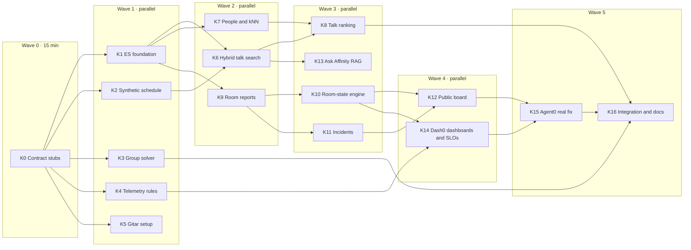

# Karthik's tasks: data and intelligence plane

> **Your half of Affinity:** everything that *knows* things. Elasticsearch (talks, people, room reports, room state, incidents), the group solver, the public board, the RAG endpoint, telemetry rules, Dash0 dashboards and SLOs, and the Gitar review setup.
>
> **Rishabh's half:** everything that *acts*. KWOK, the placement controller, taints and reroutes, Postgres and cards, sessions, SSE, and Radar.
>
> The two halves meet only at the [shared contract](#shared-contract) below. Code against the contract and never wait on Rishabh. Where you need something of his, use a fake in tests (the `FakeES` pattern in `backend/tests/test_api.py`).

Design source: [`docs/AFFINITY.md`](../AFFINITY.md). Where this file and AFFINITY.md disagree, this file wins for the build and AFFINITY.md gets updated at the end (task K16).

---

## Sponsor tracks you own

You lead three tracks. Each task below says which judging criterion it serves.

| Track | What the judges look for | Tasks that earn it |
|---|---|---|
| **4 · Elasticsearch** | Elasticsearch is the core data layer. Keyword, vector and hybrid search. RAG for AI agents. | K1, K2, K6, K7, K8, K9, K10, K11, K12, K13 |
| **2 · Dash0** | OpenTelemetry-native traces, logs, metrics and RUM. Agent0 or the Dash0 MCP finds and fixes a **real** problem. Observability inside the product. A dashboard or SLO. | K4, K10 (trace links), K12, K14, K15 |
| **1 · Gitar** | PRs reviewed against the project's conventions. Custom review instructions and rules. CI failure diagnosis. Auto-apply fixes. | K5, plus every PR you open |

How the tracks show up in your work:

- **Elasticsearch is the system of record for everything that isn't private.** Five indices plus a data stream. Live room state is computed by ES aggregations, not kept in app memory. That's what "core data layer" means.
- **Every search is hybrid.** `semantic_text` (hosted embeddings through an inference endpoint, so we run no model) is fused with BM25 using RRF. People matching uses kNN. `/api/ask` is RAG grounded in the talks index.
- **Every hop is traced.** One trace runs from a phone tap to a taint to a reroute, across two services (`affinity-api` and Rishabh's `affinity-controller`), joined by a `traceparent` stored in the room-state document. Agent0 can reason over that trace.
- **Gitar enforces the privacy model.** Its review rules are where "no card data in logs, spans, ES or Pods" is checked, PR by PR.

---

## Shared contract

> **This section is identical in `karthik.md` and `rishabh.md`.** If you change it, change it in both files in the same PR and tell the other person.

### Stack decisions (these override AFFINITY.md's tech table)

| Topic | Decision | Why |
|---|---|---|
| Language | **Python 3.11 + FastAPI**, the repo's existing backend, instead of Node.js | CI, Dockerfile, tests and telemetry are already wired for it |
| Elasticsearch | **In-cluster StatefulSet** (`deploy/elasticsearch.yaml`, trial license: RRF and inference work), instead of Serverless | It shows on Radar's topology and is already deployed |
| Embeddings | ES inference endpoint `affinity-embed` (OpenAI `text-embedding-3-small`, key from Secret `app-credentials`, key `OPENAI_API_KEY`), used by `semantic_text` | Hosted embeddings, so we run no model pod; ELSER doesn't fit a 2 GiB node |
| Private data | **Postgres** through CloudNativePG (`db-rw:5432`, Secret `db-app`) | Cards are encrypted there, never in ES |
| K8s client | `kubernetes` Python client | |
| Services | `affinity-api` (Deployment `app`, 2 replicas) and `affinity-controller` (Deployment `controller`, 1 replica, same image, `python -m app.controller`) | Two services make a real distributed trace in Dash0 and two workloads in Radar |
| Time zone | All conference times are `America/Denver`, stored with an explicit offset | |

### Who owns which files

Parallel agents must stay inside their owner's paths. Shared files are **append-only**: add your lines, don't reorder or rewrite the other person's.

| Path | Owner |
|---|---|
| `backend/app/search/`, `backend/app/solver/`, `backend/app/reports/`, `backend/app/incidents/`, `backend/app/board/`, `backend/app/ask/`, `backend/app/telemetry/` | Karthik |
| `scripts/es_setup.py`, `scripts/gen_schedule.py`, `scripts/ingest.py`, `data/sample-schedule.json` | Karthik |
| `deploy/room-state-cronjob.yaml`, `observability/dash0/`, `.gitar/`, `.github/workflows/ci.yaml` | Karthik |
| `backend/app/auth.py`, `backend/app/db/`, `backend/app/cards/`, `backend/app/k8s/`, `backend/app/controller/`, `backend/app/placements/`, `backend/app/breaks/`, `backend/app/stream/`, `backend/app/social/` | Rishabh |
| `scripts/gen_nodes.py`, `scripts/seed_demo.py`, `data/venue.json`, `backend/migrations/` | Rishabh |
| `deploy/deployment.yaml`, `deploy/controller.yaml`, `deploy/rbac.yaml`, `deploy/postgres.yaml`, `deploy/kwok/`, `deploy/priorityclasses.yaml`, `docs/radar/` | Rishabh |
| **Shared, append-only:** `backend/app/main.py` (one `app.include_router(...)` line per router), `backend/requirements.txt`, `deploy/kustomization.yaml` (`resources:` lines), `.env.example`, `backend/tests/conftest.py` (fixtures) | Both |

Karthik needs an env var on Deployment `app`? Add it in your PR as an append-only change to `env:` in `deploy/deployment.yaml` and mention it in the PR description.

### Fixed IDs

Both sides generate data from these lists, so they match without coordination.

```text
Talk slots:   tue-0900  tue-1030  tue-1330  tue-1430  tue-1600
Breaks:       brk-tue-1000  brk-tue-1530
Rooms:        room-101 (40 seats)  room-155 (80)  room-251 (120)  room-hall-b (300)
Tables:       tbl-01 .. tbl-06 (4 seats each)  tbl-quiet-window (4 seats)

Talk Node name:   <slot>-<room>      e.g. tue-1430-room-251
Table Node name:  <break>-<table>    e.g. brk-tue-1530-tbl-quiet-window
```

Capability codes (`cap-c1` … `cap-c8`) are opaque. Their meanings live only in `backend/app/cards/capabilities.py` (Rishabh). Karthik's code never sees a capability meaning: room signals use **signal names** (`captions_down`, `very_loud`, …), and the controller maps signals to capability codes.

### Elasticsearch indices

Karthik owns every mapping. "Writer" is who writes each field.

| Index | Fields | Writer |
|---|---|---|
| `talks` | `id`, `title`, `abstract` (copy_to `abstract_semantic`: `semantic_text`, `inference_id: affinity-embed`), `speakers`, `track` (keyword), `room`, `slot`, `node` (`<slot>-<room>`), `starts_at` (date, Denver offset) | Karthik |
| `people` | `attendee_id` (keyword), `interests` (text, copy_to `interests_semantic`: `semantic_text`), `updated_at`. **No name, no card text, no access needs.** | Rishabh, only through Karthik's `upsert_person` / `delete_person` |
| `room-reports` (data stream) | `@timestamp`, `room`, `slot`, `signal`, `reporter_hash` | Karthik |
| `room-state` (doc id = room id) | `room`, `status` (`open` \| `full` \| `closed`), `signals` (`captions`: `working` \| `down` \| `unknown`, `very_loud`: bool, `access_blocked`: bool), `confidence` (object), `changed_at`, `traceparent` | Karthik |
| `room-state` (same docs) | `seats_total`, `seats_free`, `controller_seen_at` (partial `update` only, never `index`) | Rishabh |
| `incidents` | `id`, `room`, `kind`, `state` (`open` \| `acknowledged` \| `resolved`), `opened_at`, `acknowledged_at`, `resolved_at` | Karthik |

### Python interfaces

Signatures are fixed. Implementations belong to the owner.

```python
# ---- Karthik provides ----
# backend/app/search/people.py
def upsert_person(attendee_id: str, interests: str) -> None: ...
def delete_person(attendee_id: str) -> None: ...

# backend/app/search/ranking.py
@dataclass(frozen=True)
class RankedNode:
    node: str      # "<slot>-<room>"
    weight: int    # 1..100, for preferredDuringScheduling
def rank_talks_for(attendee_id: str, slot: str, k: int = 10) -> list[RankedNode]: ...
    # Excludes rooms whose room-state status is "closed". Empty list if no interests.

# backend/app/search/similarity.py
def similarity_matrix(attendee_ids: list[str], k: int = 20) -> dict[tuple[str, str], float]: ...
    # Symmetric, 0..1, only pairs within each person's top-k neighbours.

# backend/app/solver/__init__.py
@dataclass(frozen=True)
class SolverPerson:
    id: str
    needs: frozenset[str]     # opaque capability codes the table must have
    blocked: frozenset[str]   # attendee ids never to group with
    met: frozenset[str]       # attendee ids already met (repeat penalty)
@dataclass(frozen=True)
class SolverTable:
    id: str                   # table Node name
    seats: int
    caps: frozenset[str]
@dataclass
class Group:
    id: str                   # "g-<8 hex>"
    table_id: str
    members: list[str]
@dataclass
class SolverResult:
    groups: list[Group]
    unplaced: list[str]
    duration_ms: int
def solve(people: list[SolverPerson], tables: list[SolverTable],
          similarity: dict[tuple[str, str], float],
          min_size: int = 2, max_size: int = 4,
          time_limit_ms: int = 5000) -> SolverResult: ...

# ---- Rishabh provides ----
# backend/app/auth.py
def current_attendee_id(request: Request) -> str: ...   # FastAPI dependency; 401 if no session
def attendee_hash(attendee_id: str) -> str: ...          # HMAC, safe for telemetry and ES

# backend/app/breaks/inputs.py
def load_break_people(break_id: str) -> list[SolverPerson]: ...

# backend/app/k8s/seats.py
def free_seats(slot: str) -> dict[str, int]: ...         # node name -> free seats
```

Until the other side's module exists, override it in your tests (`app.dependency_overrides` or `monkeypatch`). Never import across the line in a way that breaks app startup: import inside the function that needs it.

### API routes

| Owner | Routes |
|---|---|
| Karthik | `GET /api/talks/search`, `GET /api/search` (kept for the current page), `POST /api/rooms/{id}/reports`, `GET /api/board`, `GET /api/staff/incidents`, `PATCH /api/staff/incidents/{id}`, `POST /api/ask` |
| Rishabh | `POST /api/attendees`, `PUT/GET/DELETE /api/card`, `POST /api/card/share`, `GET /c/{token}`, `POST /api/placements`, `GET /api/placements/current`, `POST /api/breaks/{id}/rsvp`, `POST /api/groups/{id}/check-in`, `POST /api/connections`, `POST /api/blocks`, `POST /api/safety-reports`, `GET /api/stream` |
| Unchanged | `/healthz`, `/readyz` (never touch ES or Postgres), `/health`, `/rum.js`, `/` |

### Telemetry contract

- `OTEL_SERVICE_NAME`: `affinity-api` and `affinity-controller`.
- Span names: `room.report.received`, `room.state.updated`, `k8s.node.taint`, `placement.reconcile`, `elasticsearch.candidates`, `k8s.pod.create`, `k8s.pod.bound`, `notification.sent`, `solver.run`, `search.hybrid`, `ask.rag`.
- Allowed custom span attributes, nothing else: `room.id`, `slot.id`, `report.signal`, `placement.outcome`, `group.size`, `solver.duration_ms`, `attendee.hash`, `search.hits`, `search.query_length`. Set them only through `app.telemetry.attrs.set_attrs(span, **kw)` (Karthik, K4), which rejects unknown keys.
- Cross-service link: when Karthik writes a `room-state` change, he stores the current `traceparent`. When the controller acts on that change, it starts `k8s.node.taint` with a span **link** to it.
- Metrics, created by their owner with exactly these names:

| Metric | Type | Owner |
|---|---|---|
| `affinity_placement_duration_seconds` | Histogram | Rishabh |
| `affinity_reroute_duration_seconds` | Histogram | Rishabh |
| `affinity_unplaced_attendees` | Gauge | Rishabh |
| `affinity_alone_at_break_total` | Counter | Rishabh |
| `affinity_group_size` | Histogram | Karthik |
| `affinity_solver_duration_seconds` | Histogram | Karthik |
| `affinity_incidents_open` | Gauge | Karthik |
| `affinity_room_reports_total` (by `report.signal`) | Counter | Karthik |

### Privacy rules (both of you, every PR)

- Names, card text and access needs never reach ES, Kubernetes objects, logs, spans or the board.
- Kubernetes objects carry only random attendee IDs and opaque labels (`affinity.dev/cap-c7`).
- Secrets go in Secret `app-credentials`, created by hand. Never in git, an image, or a log.

### Workflow

Every feature lands through a PR on its own branch so Gitar reviews it (Track 1). Merging to `main` deploys. Use the `ship` skill to confirm a deploy is live.

---

## Task flow

Tasks in the same wave are independent: give each one to a different agent. A task starts when everything in its **Depends** line is merged.



**Demo-critical path:** K1 → K2 → K6 → K7 → K8 (Rishabh's controller needs ranking), and K9 → K10 (room closures drive the reroute demo). Do these first.

**Cut line if behind at 3:00 PM:** drop K13 and K11's staff PATCH, keep everything else.

---

## Tasks

### K0 · Contract stubs (wave 0, 15 minutes)

- **Depends:** nothing.
- **Owns:** `backend/app/search/__init__.py`, `backend/app/solver/__init__.py` (dataclasses only), `backend/app/telemetry/__init__.py`.
- **Do:** Create the packages with the contract's dataclasses and function signatures, each raising `NotImplementedError`. Add `backend/tests/conftest.py` with the `FakeES` fixture moved out of `test_api.py`, so every test file can share it.
- **Done when:** `pytest` passes and Rishabh can `from app.solver import SolverPerson`.

### K1 · Elasticsearch foundation

- **Depends:** K0.
- **Owns:** `scripts/es_setup.py`, `backend/app/search/mappings.py`.
- **Do:**
  1. Write an idempotent `es_setup.py` that creates, if missing:
     - inference endpoint `affinity-embed` (`PUT _inference/text_embedding/affinity-embed`, service `openai`, model `text-embedding-3-small`, key from env `OPENAI_API_KEY`)
     - the `talks`, `people`, `room-state` and `incidents` indices with the contract's mappings
     - an index template, ILM policy (delete after 2 days) and data stream for `room-reports`
  2. If `OPENAI_API_KEY` is missing, create the indices without `semantic_text` fields and log a warning. Search then falls back to BM25 only and still works.
  3. Run it in the cluster as a one-off Job (`es-setup-001`) from the built image, following `examples/agent-workflows/README.md`, with the key from `app-credentials` via `secretKeyRef`.
- **Done when:** `GET _inference/affinity-embed` succeeds and `GET talks/_mapping` shows `abstract_semantic` as `semantic_text`. A second run changes nothing.
- **Scores:** ES core data layer, hosted embeddings. Radar shows the Job.

### K2 · Synthetic schedule and ingest

- **Depends:** K0.
- **Owns:** `scripts/gen_schedule.py`, `data/sample-schedule.json`, `scripts/ingest.py`.
- **Do:** Generate about 40 talks over the contract's 5 slots × 4 rooms, with varied, realistic abstracts (startup time, eBPF, cost, OTel, platform engineering, accessibility …) and obviously synthetic speakers. Each talk has `node = <slot>-<room>` and a Denver-offset `starts_at`. Rewrite `ingest.py` to bulk-load it into `talks` (it must work before and after K1 has run). Keep `data/sample.jsonl` working for the current page.
- **Done when:** `make ingest` loads 40 talks, and every `node` matches a Node name Rishabh's generator produces from the same fixed IDs.
- **Scores:** compliance (no unlicensed KubeCon data), demo data.

### K3 · Group solver

- **Depends:** K0. No ES and no Kubernetes: pure Python.
- **Owns:** `backend/app/solver/`, `backend/tests/test_solver.py`.
- **Do:** Implement AFFINITY.md's algorithm: sort by hardness (fewest compatible tables, then most blocks) → seed → greedy fill → local search (move and swap) within `time_limit_ms` → merge singletons → report unplaced. Hard constraints: group size 2–4, table caps ⊇ every member's needs, no blocked pairs, seats ≥ group size. Objective: sum of pair similarity − repeat penalty − large penalty × unplaced. Wrap the run in span `solver.run` and record `affinity_group_size` and `affinity_solver_duration_seconds`.
- **Tests:** never exceeds size or seats; never places a blocked pair; never puts someone at a table missing a need; 2 compatible people are never left alone; 200 people finish within the time limit; seeded results are deterministic.
- **Done when:** tests pass and 200 people solve in under 5 seconds on CI.
- **Scores:** the "nobody alone" SLO depends on it.

### K4 · Telemetry rules

- **Depends:** K0.
- **Owns:** `backend/app/telemetry/`, rename in `backend/app/main.py` (`talkscout` → `affinity`), `OTEL_SERVICE_NAME` in `deploy/deployment.yaml` (append-only edit).
- **Do:**
  1. `attrs.set_attrs(span, **kw)` enforces the contract's allow-list: unknown keys raise in tests and are dropped (with a counter) in production.
  2. A logging filter that strips request bodies and query text for `/api/card*`, `/c/*` and `/api/ask`.
  3. A test that fails if any file outside `app/telemetry/` calls `span.set_attribute` directly.
  4. Rename the service to `affinity-api`.
- **Done when:** tests pass and a trace in Dash0 shows `affinity-api` with only allowed custom attributes.
- **Scores:** Dash0 (clean, intentional telemetry), privacy model.

### K5 · Gitar setup

- **Depends:** K0.
- **Owns:** `.gitar/`, `.github/workflows/ci.yaml`.
- **Do:**
  1. Add `.gitar/review/privacy.md`, `time.md` and `accessibility.md` from AFFINITY.md, adapted to Python paths.
  2. Rewrite `.gitar/review/project.md` for Affinity: span prefix rules from the telemetry contract, `/healthz` stays dependency-free, file ownership from the contract.
  3. Add rules:
     - `.gitar/rules/es-mappings.md`: when `mappings.py` changes, check that `es_setup.py` stays idempotent and that no card field is mapped.
     - `.gitar/rules/k8s-object-privacy.md`: when `app/k8s/` or `app/controller/` changes, check that Pod and Node specs contain only random IDs and `affinity.dev/cap-*` labels.
  4. Add `ruff` lint and a coverage report to CI, so Gitar has real failures to diagnose.
  5. Comment `gitar auto-apply:on` on a PR. Let Gitar fix a real lint or test failure, and keep the PR link.
- **Done when:** a PR gets Gitar comments that cite the privacy rule, and one auto-applied fix is merged.
- **Scores:** every Gitar criterion: conventions, rules, CI diagnosis, auto-apply.

### K6 · Hybrid talk search

- **Depends:** K1, K2.
- **Owns:** `backend/app/search/talks.py`, `backend/app/search/routes.py`, `backend/tests/test_search.py`.
- **Do:** `GET /api/talks/search?q=&slot=&size=`: an RRF retriever over `semantic` on `abstract_semantic` plus `multi_match` on `title^2, abstract`, filtered by `slot`, with highlights. Return `mode: "hybrid" | "keyword"` so the UI can say which ran. Span `search.hybrid` with `search.hits` and `search.query_length` only, never the query. Point `/api/search` at the same code.
- **Done when:** "make my apps boot quicker" finds the startup-time talk with no shared keywords, and tests pass with `FakeES`.
- **Scores:** ES hybrid and semantic search, the strongest Track 4 signal.

### K7 · People index and kNN

- **Depends:** K1.
- **Owns:** `backend/app/search/people.py`, `backend/app/search/similarity.py`.
- **Do:** Implement `upsert_person`, `delete_person` and `similarity_matrix`. Similarity runs a `knn` query on `interests_semantic` per person (top `k`, filtered to the given IDs), normalises scores to 0..1, and symmetrises with the max. Fallback without embeddings: `more_like_this` on `interests`. Span `elasticsearch.candidates`.
- **Done when:** with 50 seeded people in 5 interest clusters, each person's top 3 neighbours are mostly from their own cluster.
- **Scores:** ES vector search as the engine of the human part of the product.

### K8 · Talk ranking for placement

- **Depends:** K6, K7.
- **Owns:** `backend/app/search/ranking.py`.
- **Do:** `rank_talks_for(attendee_id, slot)`: read the person's interests from `people`, run the K6 hybrid query filtered to `slot`, drop rooms whose `room-state.status == "closed"`, map RRF rank to weights 100 → 1, and return `RankedNode`s.
- **Done when:** Rishabh's controller can turn the result directly into `preferredDuringSchedulingIgnoredDuringExecution` entries. Tell him when it's merged.
- **Scores:** ES directly drives Kubernetes scheduling, which is the project's core idea.

### K9 · Room reports

- **Depends:** K1.
- **Owns:** `backend/app/reports/routes.py`, `backend/app/reports/ingest.py`.
- **Do:** `POST /api/rooms/{id}/reports` with `signal` in `seats_available | standing_room | full | very_loud | captions_working | captions_down | access_blocked`. Use `current_attendee_id` and `attendee_hash` from the contract (fake in tests). Write to the `room-reports` data stream with `reporter_hash`. Rate limit to one report per reporter per room per signal every 2 minutes, enforced with an ES query (no app memory, since there are 2 replicas). Span `room.report.received`, metric `affinity_room_reports_total`. Then call K10's `recompute(room)` inline.
- **Done when:** duplicate reports return 429 and the data stream holds only hashes.
- **Scores:** ES time-series data.

### K10 · Room-state engine

- **Depends:** K9.
- **Owns:** `backend/app/reports/state.py`, `deploy/room-state-cronjob.yaml`.
- **Do:**
  1. `recompute(room)`: an ES aggregation over the last 30 minutes of `room-reports` for the room, `terms` on signal × `date_histogram` per minute. Apply `confidence = Σ weight · exp(−age_minutes / REPORT_DECAY_MINUTES)` and hysteresis (set threshold above clear threshold).
  2. On change, `update` the `room-state` doc (Karthik's fields only), with `changed_at` and the current `traceparent`, inside span `room.state.updated`.
  3. Add a CronJob `room-state-sweep` (every minute, 50m/128Mi requests, `python -m app.reports.sweep`) so states decay without new reports.
- **Done when:** 3 `full` reports flip the room to `full` within one request, and it clears on its own about 10 minutes later. Rishabh's controller sees `traceparent`.
- **Scores:** ES aggregations as live state; Dash0 cross-service trace; Radar shows the CronJob.

### K11 · Accessibility incidents

- **Depends:** K9.
- **Owns:** `backend/app/incidents/`.
- **Do:** `captions_down` and `access_blocked` reports (after confidence crosses the threshold) open an incident in ES `incidents`, one open incident per room and kind. `GET /api/staff/incidents` and `PATCH /api/staff/incidents/{id}` move `open → acknowledged → resolved` only. Staff auth is a shared `STAFF_TOKEN` header for the hackathon. Gauge `affinity_incidents_open`. Resolving an incident writes `captions: working` to room-state.
- **Done when:** a captions-down report opens exactly one incident and the PATCH flow works.
- **Scores:** feeds the "incident response" SLO in Dash0.

### K12 · Public board

- **Depends:** K10, K11.
- **Owns:** `backend/app/board/`.
- **Do:** `GET /api/board`: per room for the current slot, `status` as text (`OPEN`, `FULL`, `CLOSED`, never colour alone), `captions`, `seats_free` (Rishabh's field, if present), `open_incident: bool` and `reported_minutes_ago`. One ES `search` with no per-room loop. No attendee IDs, hashes or scheduler errors. Also show the "nobody alone" rate for the last break, read from a small ES summary doc the board writes when Rishabh posts break results (or omitted if absent).
- **Done when:** the board answers in under 100 ms against 20 rooms and contains no identifiers.
- **Scores:** observability inside the product (Dash0) and honest freshness (accessibility principle 4).

### K13 · Ask Affinity (RAG)

- **Depends:** K6.
- **Owns:** `backend/app/ask/`, `scripts/es_setup.py` (adds one endpoint).
- **Do:** Add an ES `completion` inference endpoint `affinity-chat` (OpenAI or Anthropic service, key from `app-credentials`). `POST /api/ask {question, slot?}`: retrieve the top 5 talks with the K6 retriever, then call `POST _inference/completion/affinity-chat` with a prompt grounded only in those talks. Return the answer plus the cited talk IDs. Never pass people or card data. Span `ask.rag` with `search.hits`.
- **Done when:** "Which talk at 2:30 helps a first-timer understand autoscaling?" answers with a cited talk from that slot.
- **Scores:** "RAG for your AI agents", straight from the Elasticsearch card.

### K14 · Dash0 dashboards, SLOs and RUM

- **Depends:** K4, K10. Rishabh's metrics fill in as his tasks land.
- **Owns:** `observability/dash0/`.
- **Do:**
  1. Build a dashboard "Affinity live" (export its JSON into `observability/dash0/dashboards/`): placement p95, reroute p95, unplaced now, group sizes, solver time, open incidents, report rate by signal.
  2. Add check rules (PromQL, in `observability/dash0/checks/`) for the four SLOs in AFFINITY.md: nobody alone 99%, reroute 95% within 5 s, placement success 99.5%, captions incidents acknowledged within 5 min.
  3. Add a synthetic check on `https://<team>.cnh.radarhq.io/healthz` and `/api/board`.
  4. Confirm RUM: the page loads `/rum.js` and form fields are masked.
- **Done when:** the dashboard shows live data from both services and each SLO has a check.
- **Scores:** Dash0 "dashboard or SLO" and RUM.

### K15 · Agent0 finds and fixes a real problem

- **Depends:** K12, K14, and a seeded demo (Rishabh's `seed_demo.py`, bounded to 150 attendees).
- **Owns:** nothing new; the fix goes wherever the bug is (ask the owner if it's in Rishabh's paths).
- **Do:** Run the seeded demo, then ask Agent0 (or the Dash0 MCP from Claude Code) a real question from the telemetry, for example "why is reroute p95 over 5 seconds?" or "which span dominates `placement.reconcile`?". Fix what it finds in a PR that Gitar reviews. Record the question, the evidence, and the before/after numbers. Don't stage a fake bug; if nothing is wrong, look harder at the slowest span.
- **Done when:** AFFINITY.md's Dash0 section has a real "issue found and fixed" entry with a trace link.
- **Scores:** the Dash0 criterion judges weigh most.

### K16 · Integration and docs

- **Depends:** K3, K8, K15, and Rishabh's R10.
- **Owns:** `backend/tests/integration/` (Karthik's side), AFFINITY.md sections for tracks 1, 2 and 4.
- **Do:** Add an integration test against the docker-compose ES: ingest → search → upsert people → similarity → solve. Run the full demo once with Rishabh. In AFFINITY.md, fix the tech-stack table (Python, in-cluster ES) and the build-status rows for your features, honestly.
- **Done when:** the end-to-end demo passes and AFFINITY.md claims only what works.

---

## Checkpoints with Rishabh

| When | What |
|---|---|
| After K0 / R0 | Both stub sets merged; `pytest` green on `main` |
| After K8 | Tell Rishabh `rank_talks_for` is live; he switches R6 off its fake |
| After K10 | Close a room on purpose and check his controller taints it, with the trace linked in Dash0 |
| 4:30 PM | Full demo run-through, then freeze features; only fixes after this |
