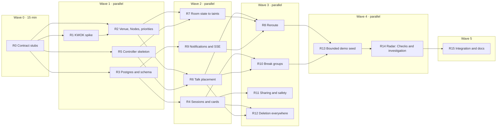

# Rishabh's tasks: control plane and platform

> **Your half of Affinity:** everything that *acts*. KWOK and the simulated venue, the placement controller, taints and reroutes, break groups bound to tables, Postgres and encrypted cards, sessions, sharing, live updates over SSE, and the Radar story.
>
> **Karthik's half:** everything that *knows* things. Elasticsearch, search and ranking, kNN similarity, the group solver, room reports and room state, incidents, the board, telemetry rules, Dash0 dashboards and Gitar setup.
>
> The two halves meet only at the [shared contract](#shared-contract) below. Code against the contract and never wait on Karthik. Where you need something of his (`rank_talks_for`, `similarity_matrix`, `solve`, `upsert_person`), use a fake in tests and a simple fallback at runtime.

Design source: [`docs/AFFINITY.md`](../AFFINITY.md). Where this file and AFFINITY.md disagree, this file wins for the build and AFFINITY.md gets updated at the end (task R15).

---

## Sponsor tracks you own

| Track | What the judges look for | Tasks that earn it |
|---|---|---|
| **3 · Radar** | Runs on Kubernetes with Radar connected. Radar UI and MCP used all day. Radar's AI SRE finds the root cause of a **real** issue. Checks before and after. | R1, R2, R5, R6, R7, R8, R10, R14, plus every deploy (the `ship` skill) |
| **2 · Dash0** (shared) | Traces and metrics from the controller, the busiest part of the system | R5, R6, R7, R8, R10 (spans and metrics in the telemetry contract) |
| **1 · Gitar** (shared) | Every feature through a reviewed PR | Every PR you open; Karthik writes the rules |
| **4 · Elasticsearch** (shared) | ES drives decisions, not just search | R6 and R10 consume ranking and kNN; R7 reads room state from ES |

How the tracks show up in your work:

- **The conference literally runs on Kubernetes.** Attendees are Pods, talks and tables are Nodes, seats are an extended resource, and `kube-scheduler` does the placing. In Radar, the topology *is* the conference. No other team will have that screen.
- **Failures are real Kubernetes failures.** A full room produces a genuine `Pending` Pod with `0/40 nodes are available: 12 Insufficient affinity.dev/seats`. That's exactly what Radar's AI investigation is built to explain, so the investigation is a natural part of the demo, not a staged one.
- **Radar is the operator's console.** Ship through Argo CD with Radar MCP, watch taints appear on Nodes when a room closes, and use Checks before and after to harden the controller and Postgres.

---

## Shared contract

> **This section is identical in `karthik.md` and `rishabh.md`.** If you change it, change it in both files in the same PR and tell the other person.

### Stack decisions (these override AFFINITY.md's tech table)

| Topic | Decision | Why |
|---|---|---|
| Language | **Python 3.11 + FastAPI**, the repo's existing backend, instead of Node.js | CI, Dockerfile, tests and telemetry are already wired for it |
| Elasticsearch | **In-cluster StatefulSet** (`deploy/elasticsearch.yaml`, trial license: RRF and inference work), instead of Serverless | It shows on Radar's topology and is already deployed |
| Embeddings | ES inference endpoint `affinity-embed` (OpenAI `text-embedding-3-small`, key from Secret `app-credentials`, key `OPENAI_API_KEY`), used by `semantic_text` | Hosted embeddings, so we run no model pod; ELSER doesn't fit a 2 GiB node |
| Private data | **Postgres** through CloudNativePG (`db-rw:5432`, Secret `db-app`) | Cards are encrypted there, never in ES |
| K8s client | `kubernetes` Python client | |
| Services | `affinity-api` (Deployment `app`, 2 replicas) and `affinity-controller` (Deployment `controller`, 1 replica, same image, `python -m app.controller`) | Two services make a real distributed trace in Dash0 and two workloads in Radar |
| Time zone | All conference times are `America/Denver`, stored with an explicit offset | |

### Who owns which files

Parallel agents must stay inside their owner's paths. Shared files are **append-only**: add your lines, don't reorder or rewrite the other person's.

| Path | Owner |
|---|---|
| `backend/app/search/`, `backend/app/solver/`, `backend/app/reports/`, `backend/app/incidents/`, `backend/app/board/`, `backend/app/ask/`, `backend/app/telemetry/` | Karthik |
| `scripts/es_setup.py`, `scripts/gen_schedule.py`, `scripts/ingest.py`, `data/sample-schedule.json` | Karthik |
| `deploy/room-state-cronjob.yaml`, `observability/dash0/`, `.gitar/`, `.github/workflows/ci.yaml` | Karthik |
| `backend/app/auth.py`, `backend/app/db/`, `backend/app/cards/`, `backend/app/k8s/`, `backend/app/controller/`, `backend/app/placements/`, `backend/app/breaks/`, `backend/app/stream/`, `backend/app/social/` | Rishabh |
| `scripts/gen_nodes.py`, `scripts/seed_demo.py`, `data/venue.json`, `backend/migrations/` | Rishabh |
| `deploy/deployment.yaml`, `deploy/controller.yaml`, `deploy/rbac.yaml`, `deploy/postgres.yaml`, `deploy/kwok/`, `deploy/priorityclasses.yaml`, `docs/radar/` | Rishabh |
| **Shared, append-only:** `backend/app/main.py` (one `app.include_router(...)` line per router), `backend/requirements.txt`, `deploy/kustomization.yaml` (`resources:` lines), `.env.example`, `backend/tests/conftest.py` (fixtures) | Both |

Karthik needs an env var on Deployment `app`? Add it in your PR as an append-only change to `env:` in `deploy/deployment.yaml` and mention it in the PR description.

### Fixed IDs

Both sides generate data from these lists, so they match without coordination.

```text
Talk slots:   tue-0900  tue-1030  tue-1330  tue-1430  tue-1600
Breaks:       brk-tue-1000  brk-tue-1530
Rooms:        room-101 (40 seats)  room-155 (80)  room-251 (120)  room-hall-b (300)
Tables:       tbl-01 .. tbl-06 (4 seats each)  tbl-quiet-window (4 seats)

Talk Node name:   <slot>-<room>      e.g. tue-1430-room-251
Table Node name:  <break>-<table>    e.g. brk-tue-1530-tbl-quiet-window
```

Capability codes (`cap-c1` … `cap-c8`) are opaque. Their meanings live only in `backend/app/cards/capabilities.py` (Rishabh). Karthik's code never sees a capability meaning: room signals use **signal names** (`captions_down`, `very_loud`, …), and the controller maps signals to capability codes.

### Elasticsearch indices

Karthik owns every mapping. "Writer" is who writes each field.

| Index | Fields | Writer |
|---|---|---|
| `talks` | `id`, `title`, `abstract` (copy_to `abstract_semantic`: `semantic_text`, `inference_id: affinity-embed`), `speakers`, `track` (keyword), `room`, `slot`, `node` (`<slot>-<room>`), `starts_at` (date, Denver offset) | Karthik |
| `people` | `attendee_id` (keyword), `interests` (text, copy_to `interests_semantic`: `semantic_text`), `updated_at`. **No name, no card text, no access needs.** | Rishabh, only through Karthik's `upsert_person` / `delete_person` |
| `room-reports` (data stream) | `@timestamp`, `room`, `slot`, `signal`, `reporter_hash` | Karthik |
| `room-state` (doc id = room id) | `room`, `status` (`open` \| `full` \| `closed`), `signals` (`captions`: `working` \| `down` \| `unknown`, `very_loud`: bool, `access_blocked`: bool), `confidence` (object), `changed_at`, `traceparent` | Karthik |
| `room-state` (same docs) | `seats_total`, `seats_free`, `controller_seen_at` (partial `update` only, never `index`) | Rishabh |
| `incidents` | `id`, `room`, `kind`, `state` (`open` \| `acknowledged` \| `resolved`), `opened_at`, `acknowledged_at`, `resolved_at` | Karthik |

### Python interfaces

Signatures are fixed. Implementations belong to the owner.

```python
# ---- Karthik provides ----
# backend/app/search/people.py
def upsert_person(attendee_id: str, interests: str) -> None: ...
def delete_person(attendee_id: str) -> None: ...

# backend/app/search/ranking.py
@dataclass(frozen=True)
class RankedNode:
    node: str      # "<slot>-<room>"
    weight: int    # 1..100, for preferredDuringScheduling
def rank_talks_for(attendee_id: str, slot: str, k: int = 10) -> list[RankedNode]: ...
    # Excludes rooms whose room-state status is "closed". Empty list if no interests.

# backend/app/search/similarity.py
def similarity_matrix(attendee_ids: list[str], k: int = 20) -> dict[tuple[str, str], float]: ...
    # Symmetric, 0..1, only pairs within each person's top-k neighbours.

# backend/app/solver/__init__.py
@dataclass(frozen=True)
class SolverPerson:
    id: str
    needs: frozenset[str]     # opaque capability codes the table must have
    blocked: frozenset[str]   # attendee ids never to group with
    met: frozenset[str]       # attendee ids already met (repeat penalty)
@dataclass(frozen=True)
class SolverTable:
    id: str                   # table Node name
    seats: int
    caps: frozenset[str]
@dataclass
class Group:
    id: str                   # "g-<8 hex>"
    table_id: str
    members: list[str]
@dataclass
class SolverResult:
    groups: list[Group]
    unplaced: list[str]
    duration_ms: int
def solve(people: list[SolverPerson], tables: list[SolverTable],
          similarity: dict[tuple[str, str], float],
          min_size: int = 2, max_size: int = 4,
          time_limit_ms: int = 5000) -> SolverResult: ...

# ---- Rishabh provides ----
# backend/app/auth.py
def current_attendee_id(request: Request) -> str: ...   # FastAPI dependency; 401 if no session
def attendee_hash(attendee_id: str) -> str: ...          # HMAC, safe for telemetry and ES

# backend/app/breaks/inputs.py
def load_break_people(break_id: str) -> list[SolverPerson]: ...

# backend/app/k8s/seats.py
def free_seats(slot: str) -> dict[str, int]: ...         # node name -> free seats
```

Until the other side's module exists, override it in your tests (`app.dependency_overrides` or `monkeypatch`). Never import across the line in a way that breaks app startup: import inside the function that needs it.

### API routes

| Owner | Routes |
|---|---|
| Karthik | `GET /api/talks/search`, `GET /api/search` (kept for the current page), `POST /api/rooms/{id}/reports`, `GET /api/board`, `GET /api/staff/incidents`, `PATCH /api/staff/incidents/{id}`, `POST /api/ask` |
| Rishabh | `POST /api/attendees`, `PUT/GET/DELETE /api/card`, `POST /api/card/share`, `GET /c/{token}`, `POST /api/placements`, `GET /api/placements/current`, `POST /api/breaks/{id}/rsvp`, `POST /api/groups/{id}/check-in`, `POST /api/connections`, `POST /api/blocks`, `POST /api/safety-reports`, `GET /api/stream` |
| Unchanged | `/healthz`, `/readyz` (never touch ES or Postgres), `/health`, `/rum.js`, `/` |

### Telemetry contract

- `OTEL_SERVICE_NAME`: `affinity-api` and `affinity-controller`.
- Span names: `room.report.received`, `room.state.updated`, `k8s.node.taint`, `placement.reconcile`, `elasticsearch.candidates`, `k8s.pod.create`, `k8s.pod.bound`, `notification.sent`, `solver.run`, `search.hybrid`, `ask.rag`.
- Allowed custom span attributes, nothing else: `room.id`, `slot.id`, `report.signal`, `placement.outcome`, `group.size`, `solver.duration_ms`, `attendee.hash`, `search.hits`, `search.query_length`. Set them only through `app.telemetry.attrs.set_attrs(span, **kw)` (Karthik, K4), which rejects unknown keys.
- Cross-service link: when Karthik writes a `room-state` change, he stores the current `traceparent`. When the controller acts on that change, it starts `k8s.node.taint` with a span **link** to it.
- Metrics, created by their owner with exactly these names:

| Metric | Type | Owner |
|---|---|---|
| `affinity_placement_duration_seconds` | Histogram | Rishabh |
| `affinity_reroute_duration_seconds` | Histogram | Rishabh |
| `affinity_unplaced_attendees` | Gauge | Rishabh |
| `affinity_alone_at_break_total` | Counter | Rishabh |
| `affinity_group_size` | Histogram | Karthik |
| `affinity_solver_duration_seconds` | Histogram | Karthik |
| `affinity_incidents_open` | Gauge | Karthik |
| `affinity_room_reports_total` (by `report.signal`) | Counter | Karthik |

### Privacy rules (both of you, every PR)

- Names, card text and access needs never reach ES, Kubernetes objects, logs, spans or the board.
- Kubernetes objects carry only random attendee IDs and opaque labels (`affinity.dev/cap-c7`).
- Secrets go in Secret `app-credentials`, created by hand. Never in git, an image, or a log.

### Workflow

Every feature lands through a PR on its own branch so Gitar reviews it (Track 1). Merging to `main` deploys. Use the `ship` skill to confirm a deploy is live.

---

## Task flow

Tasks in the same wave are independent: give each one to a different agent. A task starts when everything in its **Depends** line is merged.



R1 → R2 is a soft dependency: start R2's generator right away, and only its deploy target waits on R1's decision.

**Demo-critical path:** R1 → R2 → R5 → R6 → R7 → R8. That's "people appear as Pods, a room closes, they move". Do these first.

**Cut line if behind at 3:00 PM:** drop R11 (QR, connections, blocks) and the no-show merge in R10. Keep placement, reroute and groups.

---

## Tasks

### R0 · Contract stubs (wave 0, 15 minutes)

- **Depends:** nothing.
- **Owns:** `backend/app/auth.py`, `backend/app/breaks/inputs.py`, `backend/app/k8s/seats.py`.
- **Do:** Create the contract's functions as stubs. `current_attendee_id` raises 401; `attendee_hash` is a real HMAC-SHA256 with `SESSION_SIGNING_KEY` (defaulting to a dev value), since it's tiny; the other two raise `NotImplementedError`.
- **Done when:** `pytest` passes and Karthik can `Depends(current_attendee_id)` and override it in tests.

### R1 · KWOK spike and decision (timebox 45 minutes)

- **Depends:** R0.
- **Owns:** `docs/radar/kwok-decision.md`, `deploy/kwok/controller.yaml`.
- **Why first:** AFFINITY.md warns fake Nodes may not work in the shared environment. In a vcluster, Pods are normally synced to the host, so pause Pods could count against the team quota (500m CPU limit each, 8 Pods max). Find out before building on it.
- **Do:** Deploy the KWOK controller (`registry.k8s.io/kwok/kwok`, pinned version, 50m/64Mi requests, 250m/128Mi limits, non-root) with a ServiceAccount allowed to manage Nodes and Pods. Create one fake Node with `affinity.dev/seats: "4"` and one pause Pod that tolerates it. Through Radar (`get_resource`, `get_events`, quota usage) check:
  1. The Node survives a minute (the vcluster syncer doesn't delete it).
  2. The Pod binds to the fake Node, goes `Running` under KWOK, and **doesn't** show a host `SyncError` or raise quota usage.
  3. Radar's topology shows both.
- **Decide and write down one of:**
  - **A. vcluster-native** (all three pass): Nodes in `deploy/kwok/`, synced by Argo CD. The best Radar story.
  - **B. Nested simulator in the namespace**: a Deployment running the all-in-one `registry.k8s.io/kwok/cluster` image (its own API server, scheduler and KWOK, unprivileged), reached with a kubeconfig Secret. The controller targets it through `KUBE_TARGET_KUBECONFIG`. Show it in Radar as the controller's own Pod and logs; the conference itself is then visible through the app's staff view.
  - **C. Separate cluster**: `kwokctl` on a laptop, connected to Radar Cloud as an extra cluster (the hackathon allows this).
- **Done when:** the decision doc is merged, with Radar evidence. Every other task works for any outcome because R5's client takes its target from config.

### R2 · Venue, Nodes and priority classes

- **Depends:** R0 (generator), R1 (where the Nodes are applied).
- **Owns:** `data/venue.json`, `scripts/gen_nodes.py`, `deploy/kwok/nodes.yaml`, `deploy/priorityclasses.yaml`, `backend/app/cards/capabilities.py`.
- **Do:**
  1. Write `venue.json` from the contract's fixed IDs, with seats per room and opaque capabilities per room and table (`cap-c1` … `cap-c8`).
  2. Put the code → meaning map (captions, quiet, step-free, good lighting …) only in `capabilities.py`, and the signal → capability map that R7 uses (`captions_down` → the captions code, `very_loud` → the quiet code).
  3. `gen_nodes.py` writes one Node per slot × room and per break × table, exactly as in AFFINITY.md: `type: kwok`, `kubernetes.io/hostname`, `affinity.dev/slot`, `affinity.dev/kind`, `affinity.dev/table` on table Nodes, cap labels, and `affinity.dev/seats` in capacity and allocatable.
  4. Add PriorityClasses `affinity-hard-requirement` (value 1000, `preemptionPolicy: Never`) and `affinity-standard` (value 100).
  5. If Argo CD's apply drops Node `status`, have the controller patch `status.capacity` through the status subresource on start-up, and say so in the PR.
- **Done when:** `kubectl get nodes` (or Radar) lists 34 Nodes with seats (20 talk, 14 table), and every name matches Karthik's `talks.node` values.
- **Scores:** Radar shows the venue as Nodes.

### R3 · Postgres and schema

- **Depends:** R0.
- **Owns:** `deploy/postgres.yaml`, `backend/app/db/`, `backend/migrations/`.
- **Do:** Copy `examples/postgres/cluster.yaml` (1 instance, 1Gi, 100m/256Mi requests) into `deploy/` and add it to `kustomization.yaml`. Write the AFFINITY.md schema as `backend/migrations/001_init.sql`, plus:
  - `placement_requests(attendee_id, slot, created_at, PRIMARY KEY (attendee_id, slot))`
  - `break_rsvps(break_id, attendee_id, PRIMARY KEY (break_id, attendee_id))`
  - `notifications(id bigserial, attendee_id, kind, payload jsonb, created_at)`
  - `moves(attendee_id, slot, count)` for the move-once rule

  Add a small migration runner (`python -m app.db.migrate`) that is safe to rerun, run as a one-off Job. Use a `psycopg` connection pool with `DATABASE_URL` from Secret `db-app` (`uri` key), and keep `/healthz` and `/readyz` free of database calls.
- **Done when:** the CNPG Cluster is `Ready` and the migration Job completes twice without errors.

### R4 · Sessions and encrypted cards

- **Depends:** R3.
- **Owns:** `backend/app/auth.py`, `backend/app/cards/`.
- **Do:**
  1. `POST /api/attendees` creates a random 4–8 character ID and sets an HttpOnly, signed session cookie. Implement `current_attendee_id` for real.
  2. `PUT/GET/DELETE /api/card` encrypt the card JSON with AES-256-GCM (`cryptography`, key `CARD_ENCRYPTION_KEY` from `app-credentials`, fresh nonce per write). Needs go to the `capabilities` table as codes.
  3. If the card allows matching, call Karthik's `upsert_person(id, working_on + ask_me_about + looking_for)` and nothing else; call `delete_person` when consent is withdrawn.
  4. Never log a request body on these routes.
- **Tests:** round-trip encryption, a tampered ciphertext fails, no card field reaches the `upsert_person` fake except the consented interest text.
- **Done when:** tests pass and the `cards` table holds only ciphertext.

### R5 · Controller skeleton, RBAC and Deployment

- **Depends:** R0.
- **Owns:** `backend/app/controller/`, `backend/app/k8s/client.py`, `deploy/controller.yaml`, `deploy/rbac.yaml`.
- **Do:**
  1. `app/k8s/client.py` builds the client from in-cluster config, or from `KUBE_TARGET_KUBECONFIG` if R1 picked B or C.
  2. `python -m app.controller` runs a level-triggered loop: a watch on Pods and Nodes with label `type=kwok`, plus a full resync every 10 seconds. Each pass compares desired state (Postgres requests, ES room state) with actual state (Pods, Nodes) and fixes the difference. It must be safe to restart at any point: Pod names are deterministic (`attendee-<id>-<slot>`), so creating one twice is a no-op.
  3. Add `deploy/controller.yaml`: 1 replica, `strategy: Recreate`, 100m/192Mi requests, 500m/512Mi limits, non-root, a `/healthz` on port 8081 for probes, `OTEL_SERVICE_NAME=affinity-controller`, envFrom `app-credentials`.
  4. Add `deploy/rbac.yaml`: a ServiceAccount and ClusterRole with only nodes (get, list, watch, patch, plus `nodes/status` patch), pods (get, list, watch, create, delete), events (get, list, watch).
- **Done when:** the controller runs in Radar's topology next to `app` and `elasticsearch`, and its logs show reconcile passes.
- **Scores:** Radar (a real controller pattern), Dash0 (second service).

### R6 · Talk placement

- **Depends:** R2, R5.
- **Owns:** `backend/app/placements/`, `backend/app/controller/placement.py`, `backend/app/k8s/pods.py`, `backend/app/k8s/seats.py`.
- **Do:**
  1. `POST /api/placements {slot}` writes a `placement_requests` row. `GET /api/placements/current` returns the bound Node's room and talk, or a plain-language reason.
  2. For each request without a Pod, the reconciler builds the Pod from AFFINITY.md's example: random-ID labels only, required affinity on `type`, `affinity.dev/slot` and every needed cap label, preferred affinity from `rank_talks_for` (fallback: no preferences), priority class by whether the person has needs, the KWOK toleration, and `affinity.dev/seats: 1`.
  3. Watch for binding, record it, and write a `notifications` row.
  4. Translate `FailedScheduling` events into the attendee's message ("The matching talks at this time are full …") and never put raw scheduler text on the board.
  5. Implement `free_seats(slot)` from Node allocatable minus bound Pods.
  6. Spans `placement.reconcile`, `k8s.pod.create`, `k8s.pod.bound`. Metrics `affinity_placement_duration_seconds` and `affinity_unplaced_attendees`.
- **Tests:** a Pod spec builder test proving the spec holds only random IDs and opaque labels, and seats never exceed allocatable in a fake-client simulation.
- **Done when:** 30 seeded attendees request `tue-1430` and land across rooms, people with needs land only on Nodes with their cap, and an overfull slot leaves a visible `Pending` Pod.
- **Scores:** the core Radar picture: people as Pods.

### R7 · Room state to taints and labels

- **Depends:** R2, R5.
- **Owns:** `backend/app/controller/rooms.py`, `backend/app/k8s/nodes.py`.
- **Do:** Each pass, read `room-state` from ES (one search) and make the room's Nodes for the current and next slot match:
  - `full` → taint `affinity.dev/full:NoSchedule`; `open` → remove it.
  - `closed` → taint `affinity.dev/closed:NoExecute`.
  - `signals.captions == "down"` → remove the captions cap label; restore it on `working`.
  - `very_loud` → remove the quiet cap label.

  Write `seats_total`, `seats_free` and `controller_seen_at` back with a partial `update`. Wrap each change in span `k8s.node.taint` **linked** to the doc's `traceparent`, so Dash0 shows the report → taint → reroute chain across both services.
- **Done when:** a room-state doc set to `closed` by hand taints its Node within one resync, and Dash0 shows the linked trace.
- **Scores:** Radar shows taints appear live; Dash0 shows a cross-service trace.

### R8 · Reroute

- **Depends:** R6, R7, R9.
- **Owns:** `backend/app/controller/reroute.py`.
- **Do:** Detect Pods evicted by `NoExecute`, and Pods on Nodes that lost a capability their owner requires. Create a replacement with fresh `rank_talks_for` preferences that excludes the lost room. Allow at most one move per person per slot (`moves` table) unless the room closed. Notify the phone, and record `affinity_reroute_duration_seconds` from `room-state.changed_at` to the notification.
- **Done when:** closing `room-251` with 40 people in it spreads them over rooms with space (never overbooked), and p95 reroute is under 5 seconds.
- **Scores:** the demo's "live change" moment, visible in Radar and Dash0 at once.

### R9 · Notifications and live updates

- **Depends:** R3.
- **Owns:** `backend/app/stream/`.
- **Do:** `GET /api/stream` sends Server-Sent Events for the current attendee. The controller writes `notifications` rows and runs `NOTIFY affinity, '<attendee_id>'`. Each API replica `LISTEN`s and pushes to its connected clients, so it works with 2 replicas. On reconnect, send the latest placement first (AFFINITY.md's "API restarts" failure mode). Span `notification.sent`.
- **Done when:** a notification written by the controller reaches a browser connected to either replica within a second.

### R10 · Break groups

- **Depends:** R4, R6.
- **Owns:** `backend/app/breaks/`, `backend/app/controller/groups.py`.
- **Do:**
  1. `POST /api/breaks/{id}/rsvp` opts in. Implement `load_break_people(break_id)` from Postgres (needs, blocks, past connections and groups).
  2. Five minutes before the break, the controller calls Karthik's `similarity_matrix` and `solve` (fallback: pair people in RSVP order), writes `groups` and `group_members`, and creates one Pod per member: required node affinity to the chosen table Node, and required pod affinity on `affinity.dev/group` with `topologyKey: affinity.dev/table`.
  3. Check that each group bound completely; if it split, delete and retry the whole group.
  4. Create `card_grants` (reason `group`) that expire at the end of the break.
  5. `POST /api/groups/{id}/check-in`. After 3 minutes, merge short nearby groups whose members haven't all arrived.
  6. Count `affinity_alone_at_break_total` for opted-in people who end with no group, and post the break's summary for Karthik's board.
- **Done when:** 20 RSVPs form groups of 2–4 at tables that meet everyone's needs, with nobody alone who could have been placed.
- **Scores:** the "human part" of the demo; Radar shows groups landing on table Nodes together.

### R11 · Sharing, connections and safety

- **Depends:** R4.
- **Owns:** `backend/app/social/`, `backend/app/cards/share.py`.
- **Do:** `POST /api/card/share` returns a signed QR link (HMAC with `SHARE_SIGNING_KEY`, 10-minute expiry, revocable through `card_grants`). `GET /c/{token}` shows the card if the grant is valid. `POST /api/connections` saves a connection only when both people propose it. `POST /api/blocks` blocks (and R10's inputs respect it). `POST /api/safety-reports` stores a report for organizers without echoing its text into logs.
- **Done when:** an expired or revoked link returns 410, and a one-sided connection isn't saved.

### R12 · Deletion everywhere

- **Depends:** R4, R6.
- **Owns:** `backend/app/cards/delete.py`.
- **Do:** `DELETE /api/card` removes the attendee from Postgres (cascades), calls Karthik's `delete_person`, revokes grants, and deletes the attendee's Pods through the controller. A test checks each store with fakes.
- **Done when:** after deletion, nothing with that attendee ID remains in Postgres, ES or the cluster.

### R13 · Bounded demo seed

- **Depends:** R8, R10.
- **Owns:** `scripts/seed_demo.py`.
- **Do:** Create at most 150 synthetic attendees through the public API (never real people), with interest text in 5 clusters and a mix of needs. Rate-limited, with a hard cap and a `--dry-run`. Run it as a one-off Job (`seed-demo-001`) following `examples/agent-workflows/README.md`. Add a `--reset` that deletes only seeded IDs.
- **Done when:** one Job run fills the conference for the demo and a reset empties it.

### R14 · Radar: Checks, topology and a real investigation

- **Depends:** R13.
- **Owns:** `docs/radar/`.
- **Do:**
  1. Before hardening, save `get_cluster_audit` for `team-<team>`. Fix findings on the team's workloads (controller, app, Postgres, CronJob, KWOK): probes, requests and limits, securityContext, PodDisruptionBudget where it makes sense. Save the after audit.
  2. Capture Radar's topology with the venue loaded: Nodes as rooms, attendee Pods, the controller.
  3. When a **real** issue happens (for example attendee Pods stuck `Pending` after a reroute, a quota `SyncError`, an RBAC `Forbidden` in controller logs, or the CNPG Cluster not becoming Ready), ask Karthik or the person whether to start a hosted Radar AI investigation, then run it on that resource. Record the root cause it found and the fix PR. Don't break anything on purpose.
  4. Optional, if time allows: ship one `app` change as an Argo Rollouts canary with the `canary-release` skill.
- **Done when:** `docs/radar/` holds the before/after Checks, the topology screenshot list, and the investigation link with what changed.
- **Scores:** every Radar criterion.

### R15 · Integration and docs

- **Depends:** R14, and Karthik's K8 and K3.
- **Owns:** AFFINITY.md sections for track 3, Deployment, Architecture and Build status (your rows).
- **Do:** Remove every runtime fallback that a real implementation of Karthik's interfaces has replaced. Run the full demo script with Karthik. In AFFINITY.md, update the architecture diagram (Python, two services, in-cluster ES, where KWOK ended up per R1) and your build-status rows, honestly.
- **Done when:** the demo passes end to end and AFFINITY.md claims only what works.

---

## Budget

Everything shares one quota: 2 CPU and 4 GiB of requests, 4 CPU and 8 GiB of limits, 4 PVCs, 20 GiB. Check this table in every PR that touches `deploy/` (Gitar's budget rule does too).

| Workload | Requests | Limits | PVC |
|---|---|---|---|
| `elasticsearch` (1) | 500m / 2Gi | 1500m / 2Gi | 5Gi |
| `app` (2 replicas) | 200m / 384Mi | 1000m / 1Gi | |
| `controller` (1) | 100m / 192Mi | 500m / 512Mi | |
| `db` Postgres (1) | 100m / 256Mi | 500m / 512Mi | 1Gi |
| KWOK controller (1) | 50m / 64Mi | 250m / 128Mi | |
| `room-state-sweep` CronJob (while running) | 50m / 128Mi | 200m / 128Mi | |
| **Total** | **1000m / ~3.0Gi** | **3950m / ~4.3Gi** | **2 PVCs, 6Gi** |

Limits are within 50m of the 4 CPU cap. One-off Jobs (`es-setup`, migrations, `seed-demo`) need room to run, so give them small limits (200m) and run them one at a time, or lower `elasticsearch`'s CPU limit to 1000m first. If R1 shows that attendee Pods count against the quota, option A is off the table: go to B or C.

---

## Checkpoints with Karthik

| When | What |
|---|---|
| After R0 / K0 | Both stub sets merged; `pytest` green on `main` |
| After R1 | Share the KWOK decision; it decides what Radar will show |
| After K8 lands | Switch R6 from the no-preference fallback to `rank_talks_for` |
| After R7 and K10 | Close a room together and check the linked trace in Dash0 |
| 4:30 PM | Full demo run-through, then freeze features; only fixes after this |
